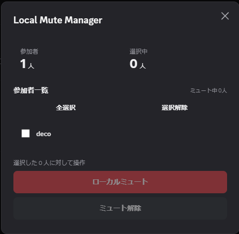
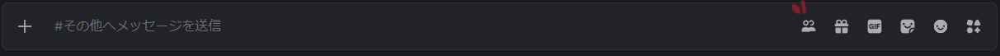
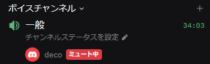

# LocalMuteManager

Vencord向けの、ボイスチャンネルのローカルミュート管理プラグインです。

Discordで参加しているボイスチャンネルのメンバーを複数選択し、ローカルミュート・ミュート解除を一括で行うことができます。



## 機能

- ボイスチャンネルの参加者一覧を表示
- 参加者を複数選択して一括ローカルミュート
- 複数人のローカルミュートを一括解除
- ミュート中のユーザーを管理画面上で確認
- Discordの参加者一覧でも、ミュート中のユーザー名の横に「ミュート中」と表示

### ローカルミュートとは

相手のマイクミュート状態に関係なく、自分の環境で特定のユーザーの声だけを聞こえないようにする機能です。

ローカルミュートの設定は自分のDiscordクライアント上だけに反映され、他のユーザーには表示されません。

## インストール手順

本プラグインを利用するには、Vencordをソースコードからビルドする必要があります。

Vencord本体のインストールや詳細については、以下の公式ページもあわせてご確認ください。

- [Vencord公式サイト](https://vencord.dev/)
- [Vencord公式ドキュメント](https://docs.vencord.dev/)

### 1. 必要なソフトウェアをインストールする

以下のソフトウェアをインストールしてください。

- [Node.js](https://nodejs.org/)
- [Git](https://git-scm.com/)
- [pnpm](https://pnpm.io/)

### 2. Vencordのリポジトリをクローンする

PowerShellなどのターミナルを開き、以下のコマンドを実行します。

```powershell
git clone https://github.com/Vendicated/Vencord
```

```powershell
cd Vencord
```

```powershell
pnpm install --frozen-lockfile
```

### 3. プラグインを配置する

クローンしたVencordのリポジトリ内にある `src/userplugins` フォルダを開きます。

`userplugins` フォルダが存在しない場合は、新しく作成してください。

その中に `localMuteManager` というフォルダを作成し、本リポジトリにある `index.tsx` を配置してください。

フォルダ構成は以下のようになります。

```text
Vencord
└── src
    └── userplugins
        └── localMuteManager
            └── index.tsx
```

### 4. Vencordをビルド・適用する

Vencordのリポジトリ直下で、以下のコマンドを順番に実行します。

```powershell
pnpm build
```

```powershell
pnpm inject
```

### 5. Discordを再起動する

Discordを完全に終了し、再度起動してください。

### 6. プラグインを有効化する

Discordのユーザー設定からVencordのプラグイン一覧を開き、`LocalMuteManager` を有効にしてください。

以上で導入完了です。

## 使い方

### 1. LocalMuteManagerを開く


画像のように、テキスト入力バーに追加される人型アイコンをクリックします。

### 2. ミュートしたいユーザーを選択する


画像のような管理画面が開きます。

参加者一覧から対象のユーザーを選択してください。複数人を同時に選択できます。

### 3. ローカルミュートを実行する

「ローカルミュート」ボタンをクリックすると、選択したユーザーを一括でローカルミュートできます。

### 4. ミュート状態を確認する



画像のように、Discordのボイスチャンネル参加者一覧で、対象ユーザーの名前の横に「ミュート中」と表示されます。

### 5. ローカルミュートを解除する

解除したいユーザーを選択し、「ミュート解除」ボタンをクリックしてください。

## 動作確認済みの環境

- OS: Windows 11
- Vencord: 動作確認時点のコミット `a8467854`
- Discord: 動作確認時点のバージョン `1.0.9269`

※上記環境で動作確認しています。すべての環境での動作を保証するものではありません。

## 連絡先

不具合や問題が発生した場合は、以下のいずれかからご連絡ください。

- X（旧Twitter）: [@deco_otaku](https://x.com/deco_otaku) のDM
- Discord: [サポートサーバー](https://discord.gg/fByHMtnVP)

不具合の内容や発生した状況、可能であればスクリーンショットも添えていただけると助かります。

できるだけ早めの返信を心掛けますが、個人で対応しているため、お時間をいただく場合があります。あらかじめご了承ください。

## ライセンス

本制作物は、個人・法人を問わず、商用・非商用を問わず無料でご利用いただけます。また、用途に合わせた改変も自由です。

ただし、本制作物について、作者の許可なく再配布・販売することを禁止します。また、公序良俗に反する目的での利用も禁止します。

Copyright (c) 2026 deco

## 注意事項・免責事項

- 本プラグインは生成AIを活用して制作されています。
- 本プラグインの使用は自己責任でお願いします。
- 本プラグインの使用によって発生した不具合、データの損失、その他の損害やトラブルについて、作者は責任を負いかねます。
- DiscordやVencordのアップデートにより、正常に動作しなくなる場合があります。
- 本プラグインは非公式のものであり、Discord Inc.およびVencord開発チームとは関係ありません。

### Discordの利用規約について

本プラグインは、非公式Discordクライアント改変ソフトウェア「Vencord」上で動作します。

Discordの利用規約では、許可されていないクライアント改変が禁止されており、本プラグインの利用も規約に抵触する可能性があります。

利用にあたっては、その点を十分に理解したうえで、自己責任でご利用ください。

- [Discord利用規約](https://discord.com/terms)
- [Vencord公式サイト](https://vencord.dev/)
